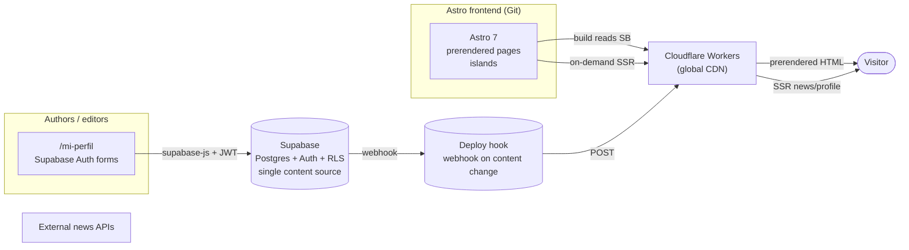
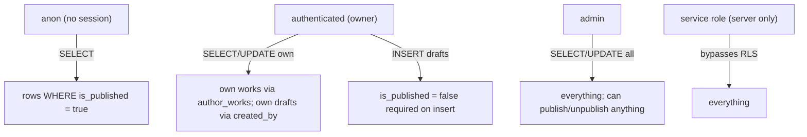

# ARCHITECTURE.md — Architecture of the site

> Living document. Every relevant decision is recorded here as an ADR (Architecture Decision
> Record). When a decision changes, **do not delete it**: mark it as superseded and add the
> new one.

---

## 1. Context and goals

**Problem.** Cuban science fiction and fantasy have a rich but poorly systematised public
record: chronologies scattered across magazines, anthology prologues, `archive.org` archives
and publisher catalogues. There is no single, citable, navigable source.

**Goal.** Build a public, fast and accessible site that:

1. Presents a **chronology** of the genre in Cuba, filterable by stage, author and milestone.
2. Maintains **author profiles** with biography, bibliography, awards and links.
3. Provides a **work catalogue** linked to its authors.
4. Publishes a **news feed** for the ecosystem (contests, awards, publications).
5. Lets **living authors maintain their own information** without bolting on a heavy CMS.

**Non-goals (for now).**

- Bookstore or sales.
- Forum or social network.
- English version (i18n).
- Native mobile apps.
- Digitisation of in-copyright full texts.

**Cross-cutting constraint.** **Zero** operating cost: everything must fit free tiers.

## 2. Overview

Two planes:

- **Editorial plane (Supabase).** Authors, works, chronology live in Postgres behind RLS.
  Authors draft and publish their own works (`is_published`); admins CRUD everything. The
  Astro build reads published rows and prerenders static HTML.
- **Delivery plane (Astro + Cloudflare).** Prerendered content pages plus SSR for news and
  authenticated user pages.

## 3. Decisions (ADRs)

### ADR-001 — Astro 7 as the framework
**Status:** accepted · **Date:** 2026-10

Content-centric site needing ultra-fast HTML and strong SEO. Astro ships zero JavaScript by
default, prerenders per route and allows isolated islands.

*Alternatives rejected:* Next.js (too much runtime), Hugo/Eleventy (no typed validation,
no islands), WordPress (cost, security).

### ADR-002 — Superseded: hybrid Git + Supabase content
**Status:** superseded by ADR-010 · **Date:** 2026-10-25

Originally the plan was split content: editorial data in Git (Content Collections), editable
author data in Supabase. Replaced because maintaining two content planes duplicated the
schema, the UI and the validation logic. All editorial content now lives in Supabase.

### ADR-010 — Content in Supabase; prerender at build; rebuild via deploy hook
**Status:** accepted · **Date:** 2026-10-25

**Decision.** The Astro frontend prerenders all content pages at build time by querying
Supabase (`authors`, `works` where `is_published = true`). On content change, a
Supabase webhook calls a Cloudflare Deploy Hook (debounced) to trigger a rebuild. The last
good deployment stays live while a build runs or fails.

| Approach | Build cost | Runtime cost | Freshness | Fit for free tier |
| --- | --- | --- | --- | --- |
| Full SSG, no rebuild hook | low | zero | stale until manual redeploy | OK |
| Full SSR | high per request | high (Workers) | instant | 100k req/day |
| **Prerender + deploy hook (chosen)** | low | zero | deploy latency (minutes) | **best fit** |
| ISR / on-demand revalidate | medium | medium | near-instant | needs Node adapter |

*Why not full SSR:* Cloudflare Workers free tier caps at 100k requests/day; each content page
view would consume one. Prerendered HTML is served from the CDN at zero invocation cost.

*Why not Git-based collections:* the DB already owns auth/RLS/users; adding a second
content plane (files + Zod collections) duplicated schema and validation. Supabase is now
the single source of truth.

*Build-time DB dependency:* if Supabase is unreachable at build, the build fails and the
previous deployment stays live. Mitigation: keep a local seed snapshot for offline
development; monitor remote builds.

### ADR-003 — Cloudflare as the deployment platform
**Status:** accepted

| Platform | Advantage | Free tier |
| --- | --- | --- |
| **Cloudflare** (chosen) | Unlimited bandwidth, 300+ PoPs, no cold starts, 100k req/day Workers | 500 builds/month |
| Vercel | Best DX, per-branch previews | Hobby restricted to non-commercial use |
| Netlify | Built-in forms | 300 build minutes/month |
| Render | Simple | Free service sleeps after 15 min |

### ADR-004 — Supabase for database and authentication
**Status:** accepted

Managed PostgreSQL + Auth + Row Level Security from a single free provider (500 MB, 50k
monthly active users). RLS expresses the project's most important business rules:
"an author edits only their own works" and "only admins manage authors and reference data".

### ADR-005 — News via Live Content Collections / server fetch
**Status:** accepted · **Requires adapter**

The news feed is fetched server-side (Live Content Collections preferred; plain `fetch`
fallback) and cached with `routeRules`. Mandatory fallback on API failure.

### ADR-006 — Tailwind CSS 4 via the Vite plugin
**Status:** accepted

Utilities for fast layout; `@tailwindcss/typography` for biography bodies.

### ADR-007 — No headless CMS in phase 1
**Status:** accepted, revisable

Git + Supabase Auth + RLS forms replace a CMS panel for v0.

### ADR-008 — A single language: Spanish
**Status:** accepted

`lang="es-CU"`, `Intl` for dates/numbers. Code, docs and commits in English.

### ADR-009 — No ORM; Supabase clients + plain SQL migrations
**Status:** accepted · **Date:** 2026-10-25

The application talks to PostgreSQL through `@supabase/supabase-js` (PostgREST over HTTPS,
carrying the user's JWT); SSR cookie handling uses `@supabase/ssr`. Schema is managed with
the Supabase CLI and `.sql` migrations.
Types generated into `src/lib/database.types.ts` and committed.

Three reasons (full rationale in earlier version of this doc, kept valid):

1. **RLS is the security model.** An ORM with a single privileged role silently bypasses
   every policy. Re-implementing JWT propagation per query is high-risk complexity this
   project cannot afford.
2. **Runtime fit.** `supabase-js` is HTTPS + `fetch`; runs unmodified on Cloudflare Workers.
   Direct `pg` needs TCP sockets + pooler — new failure modes.
3. **Queries are trivial.** Four tables, single-table reads plus one join. PostgREST covers
   it; an ORM adds a dependency and a second schema to sync.

**Hard rules:** no ORM in `src/`; the app uses only the anon key and RLS; service-role access
is restricted to offline scripts such as `scripts/seed.mjs`.

## 4. Data model

The canonical definition is `supabase/migrations/20261025000000_init.sql`. Tables:

| Table | Purpose |
| --- | --- |
| `roles` | `admin` | `author`. Reference data, not writable by app users. |
| `users` | 1:1 with `auth.users`; links a Supabase Auth user to a role. |
| `genres` | Literary genres (reference data). |
| `editorials` | Publishers (reference data). |
| `authors` | Public author profiles (`slug`, `fullname`, `pseudonyme`, `age`, `birthdate`, `biography`, `owner_user_id`). The table has no `is_published` column. |
| `works` | Bibliography (`slug`, `type`, `title`, `genres`, `year`, `edition_number`, `cant_pages`, `link`, `is_published`, `created_by`). No `editorial_id` column — editorials live in `editorial_work`. |
| `author_works` | Junction table: `(author_id, work_id)`. A work may have zero, one or many authors (co-authored books, anthologies). |
| `editorial_work` | Junction table: `(work_id, editorial_id)`. A work may be co-published by several editorials. |

`is_published` lives **only on `works`** (not on `authors`). It marks whether the work itself
is visible to the public.

Work `type` enum: `short_story`, `novel`, `poetry`, `play`, `essay`, `chronicle`, `anthology`,
`comic`.

Genres are stored as `smallint[]` referencing `genres.id` (not a separate junction table —
the spec says genres come "from the list").

### 4.1 RLS model

Invariants that must hold after every migration:

1. Every content table has RLS enabled with explicit select/insert/update policies.
2. `roles` and `genres`/`editorials` are read-only for `authenticated`; writes are admin-only.
3. Only admins can change `authors.owner_user_id` or `works.created_by` (column-level trigger).
4. Authors CRUD only works linked to their own author record via `author_works`.
5. Inserts require `is_published = false` (drafts only); anyone can toggle `is_published` on
   works they own/create.
6. `author_works` inserts/deletes are allowed only for the owner of the linked `authors` row
   (or an admin).

**Verification status:** the migration was applied to a clean PostgreSQL 18 instance with a
stubbed `auth` schema (`auth.users`, `auth.uid()`, `anon`/`authenticated` roles) and the
following behaviours were asserted successfully:

| # | Assertion |
| --- | --- |
| 1 | Signup trigger (`handle_new_user`) creates a `users` row with default `author` role |
| 2 | Insert with `is_published = true` is denied for non-admins |
| 3 | Author reads own works via `author_works` / `created_by` |
| 4 | Author updates own linked work |
| 5 | Author toggles `is_published` on own work |
| 6 | Author creates a draft work and links it via `author_works` |
| 7 | Author cannot link a work to another author's record |
| 8 | Author cannot create author records or write reference data (genres/editorials) |
| 9 | Another author cannot see, update or delete another author's draft work |
| 10 | Anonymous readers see only `is_published = true` works |
| 11 | Admin CRUDs genres, editorials, authors, works, author links and co-edition links |
| 12 | Admin links an anthology/work to every author included in it |

Re-run these checks after any schema change; they are the regression suite for the security
model.

## 5. Routes and rendering modes

| Route | Mode | Content |
| --- | --- | --- |
| `/` | SSG (prerender) | Highlights, latest news (deferred island), entry points |
| `/autores` | SSG (prerender) | List of published authors |
| `/autores/[slug]` | SSG (prerender) | Author profile + works |
| `/obras` | SSG (prerender) | Published works catalogue |
| `/obras/[slug]` | SSG (prerender) | Work detail |
| `/cronologia` | SSG (prerender) | Timeline of published milestones |
| `/noticias` | SSR (`prerender = false`) | Live news feed |
| `/mi-perfil` | SSR | Authenticated editing |
| `/entrar`, `/salir` | SSR | Auth |
| `/buscar` | SSG + island | Client-side search over a build-time index |
| `/acerca`, `/fuentes`, `/licencia` | SSG | Editorial transparency |

Historical stages (pioneers/1960s, 1980s, 1990s, 2000s onward) are a presentation constant;
filtering is by `year` ranges.

## 6. Authentication and authorization

1. Sign-up via Supabase Auth (email + password or magic link).
2. The `handle_new_user` trigger creates a `users` row with the default `author` role.
3. An admin creates `authors` records and sets `owner_user_id` to the claimant's `users.id`.
   The author can now draft and publish works linked to that author record via `author_works`.
4. Drafts have `is_published = false`; the author (owner) can toggle `is_published` on their
   own works. Only admins can CRUD `authors`, `genres`, `editorials` and co-edition links.

**Hard rule:** sessions validated server-side on every SSR page via `Astro.locals.user`
(populated in `src/middleware.ts`). The client never decides who is an admin.

## 7. Performance and caching

- Budget: HTML < 45 KB compressed, CSS < 30 KB, island JS < 20 KB per page, LCP < 2.0 s on fast 3G.
- No UI frameworks in the initial bundle.
- Images via `astro:assets` `<Image />` (AVIF/WebP, explicit dimensions).
- `routeRules` for news: short `maxAge` + `swr`.
- Self-hosted fonts; no Google Fonts.

## 8. SEO and structured data

- Unique `<title>` / `meta description` per route; absolute canonical.
- `@astrojs/sitemap` + `robots.txt`.
- JSON-LD: `Person`, `Book`, `Event`, `WebSite` with `SearchAction`.
- Internal links author ↔ work ↔ chronology.

## 9. Security

- Headers: strict CSP, `X-Content-Type-Options`, `Referrer-Policy`, `Permissions-Policy`,
  HSTS.
- Zod validation of every Supabase response at the app boundary.
- Rate limiting on auth endpoints.
- No `set:html` on user content.
- Service role key only in server environment variables.
- `pnpm audit` in CI; monthly dependency review.

## 10. Free-tier limits and thresholds

| Resource | Limit | Alarm |
| --- | --- | --- |
| Cloudflare builds | 500/month | 300 → debounce webhook, cache builds |
| Workers requests | 100k/day | 60k → prerender more pages |
| Supabase database | 500 MB | 350 MB → archive old drafts |
| Supabase Auth | 50k MAU | — |
| Bandwidth | Unlimited (Cloudflare) | — |

## 11. Risks

| Risk | Impact | Mitigation |
| --- | --- | --- |
| Wrong or unsourced historical data | Loss of credibility | Every work row carries a `link` to its source; seed data records provenance in `meta.notes`; publish gate |
| Supabase unreachable at build | Build fails, old deploy stays live | Previous deployment remains active; monitor builds |
| News API unstable | Broken feed | Server-side fallback + cached headlines |
| Single maintainer | Abandonment | Docs in `DOCS/`, data in open SQL/JSON |

## 12. Planned evolution

1. Dataset export (JSON/CSV) for researchers (CC BY-SA).
2. Public read-only API over the tables.
3. Full-text search (Pagefind over prerendered HTML).
4. English version if academic demand appears.
5. Editorial panel if form-based editing becomes insufficient.
